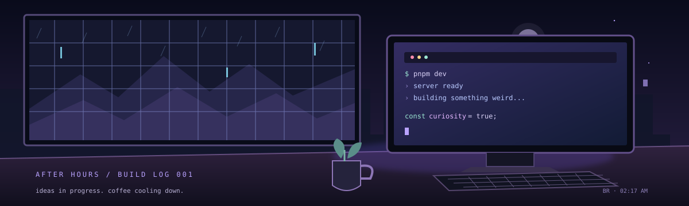
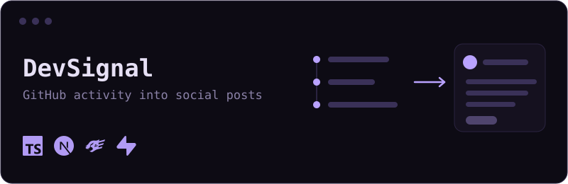
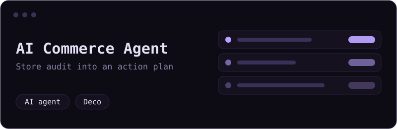
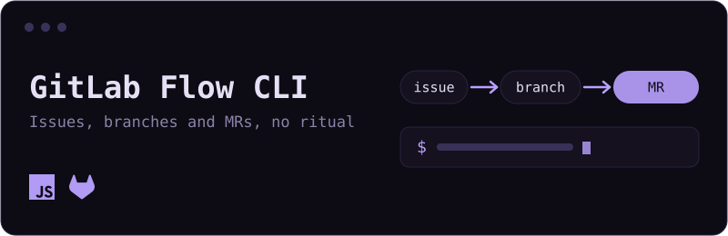
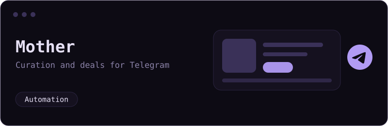

🇧🇷 [Leia em português](README.pt-BR.md)

[ [repos](https://github.com/misareverberate?tab=repositories) ] · [ [things I find interesting](https://github.com/misareverberate?tab=stars) ] · [ [commit trail](https://github.com/misareverberate?tab=activity) ]

<!-- Optional: uncomment and edit if you're open to opportunities

**Open to junior back-end roles** · TypeScript · Node.js · PostgreSQL

-->

---

### ~/whoami

Computer Science student from Brazil. I learn by building stuff, breaking it, and trying again, usually somewhere between backend, APIs, developer tools, game dev, cybersecurity and AI experiments.

I have more ideas than time. Some become projects; some stay in a notes file until 2 AM.

---

### ~/workbench

<table>
  <tr>
    <td width="50%" valign="top">
      
      <h4><a href="https://github.com/misareverberate/dev-link">DevSignal</a></h4>
      Turns GitHub activity into social content with AI, so building in public takes minutes instead of an evening.
    </td>
    <td width="50%" valign="top">
      
      <h4><a href="https://github.com/misareverberate/hackathon-deco">AI Commerce Agent</a></h4>
      Audits an online store and turns the findings into prioritized opportunities and an action plan. Built at the Agents for Commerce hackathon.
    </td>
  </tr>
  <tr>
    <td width="50%" valign="top">
      
      <h4><a href="https://github.com/misareverberate/gitlab-flow-cli">GitLab Flow CLI</a></h4>
      A little CLI that makes issues, branches and merge requests less of a ritual.
    </td>
    <td width="50%" valign="top">
      
      <h4><a href="https://github.com/misareverberate/mother">Mother</a></h4>
      Product curation and deal-post automation for Telegram.
    </td>
  </tr>
</table>

Some are experiments, some are work in progress. That's kind of the point.

---

### ~/beyond-the-repos

<table>
  <tr>
    <td width="33%" valign="top">
      <h4>🤖 Robotics</h4>
      State robotics champion. Competed for several years, and now prepping for a new competition with Artrobots, covering computing, mechanics and electronics.
    </td>
    <td width="33%" valign="top">
      <h4>⚡ Hackathons</h4>
      Two this semester, one with a team and one solo: Agents for Commerce (Deco) and Runflow + Oracle Journey, where I built an AI agent that classifies leads.
    </td>
    <td width="33%" valign="top">
      <h4>🧭 Community</h4>
      Computing Coordinator at NOI. Finance Director at Code Club, plus Code Kids and hackathon organization. Events Director at Echosec (COPASEG). Still shipping game projects at GameLab.
    </td>
  </tr>
</table>

---

<!-- Add your own, for example:

-->

 

`make things / break things / learn something / repeat`

